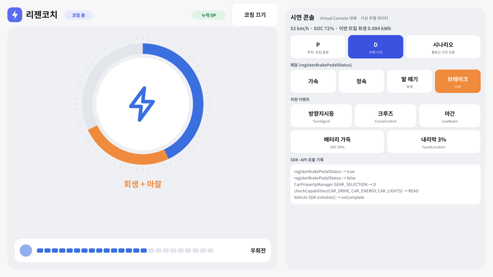
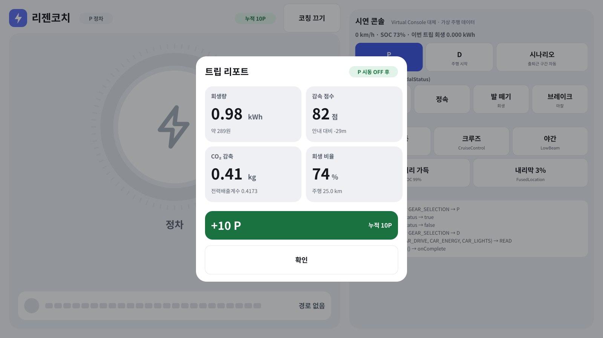

# 리젠코치 (Regen Coach)

감속할 때 회생제동이 얼마나 작동하는지 차량 화면에 보여주고, 회수한 에너지만큼 포인트로 돌려주는 회생제동 코칭 앱입니다.

- 팀명: 오.
- 공모전: 현대자동차그룹 차량용 앱 개발 공모전 (Pleos Connect)

## APK 파일

| 항목 | 위치 |
|---|---|
| Release APK | [`apk/오._RegenCoach_release.apk`](apk/) |
| 빌드 방식 | `main` 브랜치에 push 하면 GitHub Actions(`.github/workflows/build-apk.yml`)가 release APK 를 빌드해 `apk/` 폴더에 자동 커밋 |
| Actions 아티팩트 | 저장소 Actions 탭 → 최신 실행 → `regen-coach-release-apk` |

## 주요 기능

| 기능 | 설명 | 사용 SDK·API |
|---|---|---|
| 실시간 회생 코칭 | 감속할 때 회생·마찰 제동 비중을 3색 링 게이지(파랑 회생 / 주황 마찰 / 회색 마찰만)로 표시. 주행 중에는 숫자 없이 색과 게이지만 사용 | CAR_DRIVE `getCurrentBrakePedalStatus`, CAR_ENERGY `getInstantaneousEvEfficiency` |
| 예측 감속 안내 | 다음 안내 지점까지 남은 거리로 발 떼는 시점을 계산해 하단 진행 바와 링 테두리 점멸로 안내 | NaviHelper 경로 정보(TBT), FusedLocation(경사 보정), CAR_DRIVE `getCurrentDrivingModeState` |
| 주행 환경 맞춤 표시 | 전조등이 켜지면 야간 테마, 실내 밝기에 맞춰 게이지 밝기 조절, 방향지시등·크루즈·급조향 중 코칭 숨김 | CAR_LIGHTS `getCurrentLowBeamLightState`, `getAmbientLightBrightness`, `getCurrentTurnSignalState`, CAR_DRIVE `getCruiseControlState`, `getCurrentSteeringWheelAngle` |
| 트립 리포트 | P단 전환 시 회생량(kWh), 절감액(원), CO₂ 감축량(kg), 회생 비율, 감속 점수 표시 | CAR_DRIVE `getTripCurrentDrivingDistance`, CAR_ENERGY `getEvBatteryStateOfCharge` |
| 에코 포인트 | 회생량 1kWh당 10P 적립(앱 자체 기준), 짧은 주행은 적립 제외 | 앱 내부 |

### 판정·계산 로직

`app/src/main/java/com/team_o/regencoach/domain/RegenEngine.kt`

- 감속 판정: 순간 주행거리 ÷ Δt 로 속도를 구해 이동평균 후 감속도 계산
- 제동 상태: 감속 중 + 브레이크 페달 + 순간 전비 회생 신호 조합으로 회생만 / 회생+마찰 / 마찰만 구분
- 회생량: 운동에너지 변화(½mv²) × 차종별 회생 계수로 적산
- 예측 안내: `a = max(a_c × k_mode + g × sinθ, a_min)`, `d = (v² − v_t²) ÷ 2a`, `D_trigger = d + v × t_r`
- 감속 점수: `S = (1 − |D_release − D_trigger| ÷ D_trigger) × 100`

## 실행 방법

1. `apk/오._RegenCoach_release.apk` 를 Pleos Connect 에뮬레이터(또는 Android 10 이상 기기·에뮬레이터)에 설치합니다.
   ```
   adb install -r "apk/오._RegenCoach_release.apk"
   ```
2. 앱을 실행하면 오른쪽 **시연 콘솔**에서 가상 주행 데이터를 조작할 수 있습니다.
   - `D` 로 주행 시작 → `가속` → `발 떼기`(회생, 파란 링) 또는 `브레이크`(회생+마찰, 주황 링)
   - `배터리 가득` 을 켠 뒤 브레이크를 밟으면 마찰만(회색 링)
   - `방향지시등`, `크루즈` 를 켜면 코칭 표시가 숨겨짐, `야간` 을 켜면 야간 테마
   - `P` 로 전환하면 트립 리포트와 포인트 적립 화면이 열림
   - `시나리오` 를 누르면 출퇴근 구간 한 번을 자동 재생
3. 소스에서 직접 빌드하려면
   ```
   ./gradlew assembleRelease
   ```
   결과물: `app/build/outputs/apk/release/app-release.apk`

## 테스트 환경 및 필요한 설정

| 항목 | 값 |
|---|---|
| 언어 / UI | Kotlin 2.0.20, Jetpack Compose (BOM 2024.09.00) |
| 빌드 | Android Gradle Plugin 8.5.2, Gradle 8.9, JDK 17 |
| SDK | compileSdk 34, targetSdk 34, minSdk 29 |
| 권장 화면 | 가로 레이아웃 (Pleos Connect 앱 윈도우 전체 모드) |
| 서명 | 저장소의 `app/release.jks` 로 release 서명 (심사용). 실제 배포 시 GitHub Secrets 로 교체 |
| 데이터 | 기본은 `SimulatedVehicleDataSource`(가상 주행). 실차 연동은 `PleosVehicleDataSource` |

### Pleos Vehicle SDK 연동

Vehicle SDK AAR 은 Pleos Playground 에서만 받을 수 있어 저장소에 포함하지 않았습니다.

1. Playground 에서 받은 AAR 을 `app/libs/` 에 넣습니다.
2. `app/build.gradle.kts` 의 `fileTree` 의존성 주석을 해제합니다.
3. `data/PleosVehicleDataSource.kt` 의 TODO 위치에 SDK 호출을 연결하고, `RegenViewModel` 의 데이터 공급원을 교체합니다.

화면과 계산 로직은 `VehicleDataSource` 인터페이스만 보므로 바꿀 필요가 없습니다. SDK 응답은 Loading / Ready / Unsupported / PermissionRequired / Error 다섯 상태로 화면에 표시됩니다.

## 개발에 사용한 Pleos Connect 에뮬레이터

| 항목 | 값 |
|---|---|
| 에뮬레이터 | Pleos Connect Emulator (Android Studio AVD, Automotive 디바이스) |
| 시스템 이미지 | Pleos Connect System Image 2.x, Android API 34 |
| 이미지 저장소 | Windows/Linux `https://nexus-playground.pleos.ai/repository/raw-releases/connect-avd/2.x/crp-sys-img.xml` · Mac `.../connect-avd/2.x/crp-arm64-sys-img.xml` |
| AVD 설정 | Boot option Cold boot, RAM 4 GB (Pleos 개발 가이드 권장값) |
| 화면 규격 | Pleos Connect Automotive 디바이스 기본 프로필, 가로(Landscape) 앱 윈도우 전체 모드 기준으로 레이아웃 설계 |
| 앱 요구 사항 | minSdk 29 (가이드 기준 API 28 이상 충족), compileSdk·targetSdk 34 |

> 개발 PC 사양 문제로 에뮬레이터 실기동 캡처 대신, 앱 코드(Jetpack Compose)와 같은 레이아웃·색상 토큰으로 그린 화면 재현 이미지를 함께 첨부합니다. 에뮬레이터에서 `adb shell wm size`, `adb shell wm density` 로 확인한 해상도는 확보 후 이 표에 추가합니다.

### 설치 방법 (Pleos Connect Emulator)

1. Android Studio → Tools → SDK Manager → SDK Update Sites → Add 에 위 이미지 저장소 URL 등록
2. SDK Platforms 에서 API 34 Pleos Connect system image 설치 후 Android Studio 재시작
3. Tools → Device Manager → Create device → Automotive → Pleos Connect 디바이스 생성 (Cold boot, RAM 4 GB)
4. 에뮬레이터 실행 후 APK 파일을 창으로 드래그 앤 드롭하거나 `adb install -r apk/오._RegenCoach_release.apk`

일반 Android 태블릿·에뮬레이터(Android 10 이상)에서도 시뮬레이션 모드로 실행됩니다. 휴대폰은 가로 방향으로 확인하세요.

## 화면

화면 재현 이미지 (Day 테마, 가로 1600×900 기준)

| 실시간 코칭 (회생 + 마찰) | 트립 리포트 (P 전환 시) |
|---|---|
|  |  |

- 왼쪽: 3색 링 게이지(파랑 회생 / 주황 마찰), 현재 제동 상태, 예측 감속 안내 바
- 오른쪽: 시연 콘솔(가상 주행 조작)과 SDK·API 호출 기록
- P 전환 시: 회생량, 감속 점수, CO₂ 감축, 회생 비율, 에코 포인트

## 디자인 시스템

앱 화면은 팀이 정리한 [Pleos Design System v2](docs/pleos-design-system.html) 를 기준으로 만들었습니다. 브라우저에서 파일을 열면 색·타이포·컴포넌트·SDK 연동 패턴·출품 체크리스트를 볼 수 있습니다.

| 디자인 시스템 규칙 | 앱 반영 위치 |
|---|---|
| Day / Night 색 토큰 | `ui/theme/Theme.kt` 의 `DayColors`, `NightColors` |
| 간격·모서리 토큰 (4~48dp, 14/20/28dp) | `PdsSpace`, `PdsRadius` |
| 주행 중 터치 최소 76dp, 주요 액션 96dp | `PdsTouch`, 시연 콘솔·코칭 끄기 버튼 |
| 주행 중 숫자·문장 최소화, 상세 정보는 P단에서 | 링 게이지는 색만 표시, 트립 리포트는 P 전환 시 표시 |
| SDK 다섯 상태 (Loading·Ready·Unsupported·PermissionRequired·Error) | `data/VehicleData.kt` 의 `VehicleUi`, 화면의 `StateView` |
| 상태바 정보(시계·배터리·속도) 중복 금지 | 앱 상단에 시계·배터리 표시 없음 |
| 앱 아이콘 둥근 사각 + 그라디언트 | `res/drawable/ic_launcher_*` |

> 출처: 디자인 시스템 문서의 드라이빙 뷰 등 화면 이미지는 Pleos Connect 공식 화면 목업 캡처를 공모전 참고용으로 사용했습니다. 현대자동차그룹·Pleos 로고와 공식 앱 아이콘은 포함하지 않았으며, 색 토큰은 공식 System Color 가 아닌 팀 정의 값입니다.

## 프로젝트 구조

```
docs/
├─ pleos-design-system.html      # 디자인 시스템 문서
├─ screen_coaching.png           # 화면 재현 이미지
└─ screen_trip_report.png

app/src/main/java/com/team_o/regencoach/
├─ MainActivity.kt
├─ RegenViewModel.kt
├─ data/
│  ├─ VehicleData.kt                 # 차량 신호 모델, 다섯 가지 SDK 상태
│  ├─ SimulatedVehicleDataSource.kt  # 가상 주행 데이터 (10Hz)
│  └─ PleosVehicleDataSource.kt      # Pleos Vehicle SDK 연동부
├─ domain/
│  └─ RegenEngine.kt                 # 제동 판정, 회생량 적산, 예측 안내, 트립 리포트
└─ ui/
   ├─ RegenCoachScreen.kt            # 코칭 화면, 시연 콘솔, 트립 리포트
   ├─ Components.kt                  # 3색 링 게이지, 예측 안내 바
   └─ theme/Theme.kt                 # Pleos Design System v2 토큰 (Day/Night)
```
